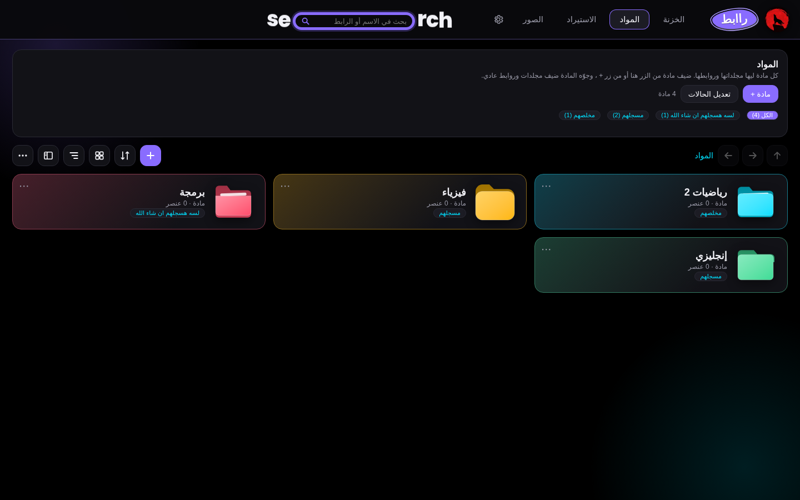
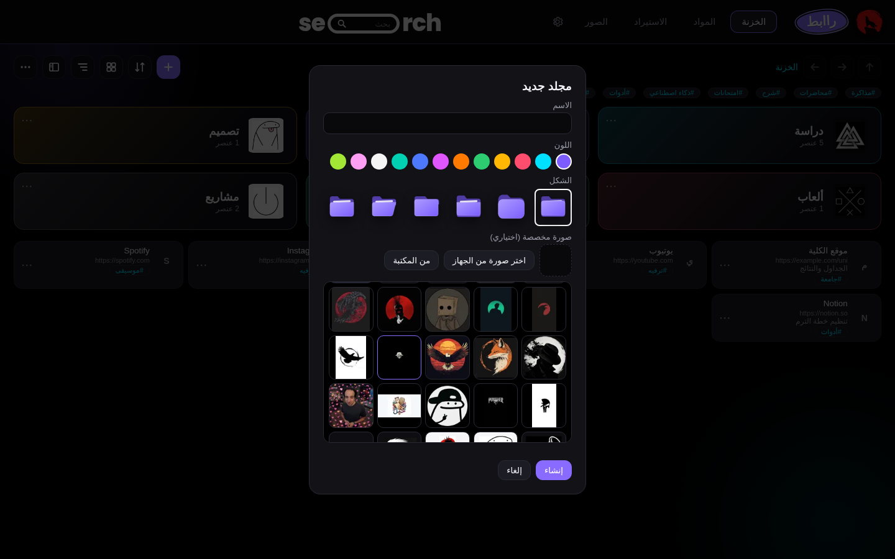
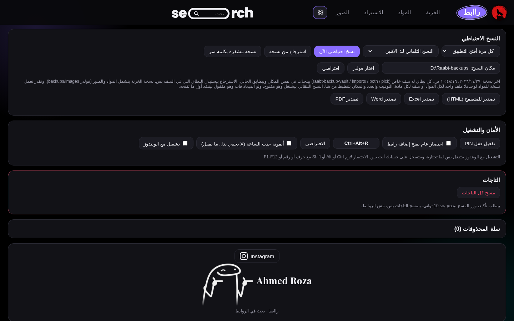

<div align="center">
  
</div>

<div align="center">


</div>

<div dir="rtl">

# راابط

> لكل رابط فتحته وقلت لنفسك: هرجعله بعدين.
> ولكل تاب سيبته مفتوح لحد ما الجهاز تعب.
> ولكل فكرة بدأت من سطر صغير في شريط العنوان وضاعت في الزحمة.
>
> **راابط** بيعمل حاجة واحدة، وبيعملها صح:
> بيحط روابطك في مكان واحد، مرتّب زي ما إنت عايز، بيفتح في لمحة، وشغّال من غير ما يشوف نت أصلًا.
>
> مش حساب على سيرفر، ولا مفضلة بتتبعت لحد.
> رفّ صغير، على جهازك، فيه كل اللي جمعته… ومحدش بيشوفه غيرك.

راابط برنامج ويندوز خفيف (حوالي 10 ميجا) بتحطه في أي فولدر وتشغّله على طول، من غير تنصيب. كل حاجة فيه — الروابط، الصور، الخطوط، النسخ الاحتياطية — بتتخزن في فولدر `Raabt-data` جنب البرنامج، فتقدر تنقله على فلاشة وتشيله معاك، أو تنسخه كله في ثانية.

---

## المميزات

**خزنة مرتّبة على مزاجك**
- مجلدات جوه مجلدات، بأي عمق، بألوان وأشكال وعناوين زي ما تحب.
- لكل رابط تاج وملاحظة قصيرة تظهر تحته.
- 41 صورة جاهزة تختار منها صورة أي مجلد، وتقدر تضيف صورك من الجهاز.
- سحب وإفلات لترتيب كل حاجة.
- ثيم أسود كامل وثيم فاتح، والخط تختاره من 14 خط مضمّن أو من خطوط جهازك.

**قسم المواد**
- كل مادة (كورس، ترم، مشروع) بتبقى قسم لوحده جواه مجلدات وروابط.
- حالات للمواد: «لسه هسجلهم ان شاء الله» و«مسجلهم» و«مخلصهم»، وتقدر تعدّل الحالات نفسها وتضيف وتشيل.
- أي مجلد أو رابط من الخزنة ينفع يتحط جوه مادة.

**بحث سريع**
- `Ctrl + K` أو `Ctrl + F` من أي مكان، وبحث في القسم الحالي أو في كل الأقسام.
- فلتر بالمادة أو التاج، وتفتيح النتيجة على طول.

**استيراد من المتصفحات**
- استيراد ملف المفضلة من Chrome وFirefox وBrave وEdge وغيرهم.
- بيسألك: استيراد جديد ولا كتابة فوق استيراد قديم لنفس المتصفح؟ مع تأكيد قبل التنفيذ، وتراجع بعدها لو غيرت رأيك.
- الكتابة فوق بتحافظ على تعديلاتك: الأسماء والصور والتاجات والملاحظات.

**تصدير ونسخ احتياطي**
- تصدير HTML يفتح في أي متصفح، وExcel وWord وPDF.
- تختار مجلدات وروابط معيّنة بس، أو الخزنة كلها.
- PDF بيتحفظ على طول من غير نافذة طباعة، بشجرة المجلدات وأسماء الروابط قابلة للضغط.
- نسخة احتياطية تلقائية كل عدد ساعات تحدده، أو يومي وأسبوعي وشهري، وفي المكان اللي تختاره.

**حاجات صغيرة بتفرق**
- فحص الروابط اللي مش بتفتح، لمجلد معيّن أو للخزنة كلها.
- فتح كل روابط أي مجلد بضغطة.
- تشغيل مع ويندوز، أيقونة جنب الساعة، واختصار عام (Ctrl+Alt+R افتراضيًا) — مش بيشتغلوا غير لما تفعّلهم بنفسك من الإعدادات.
- قفل PIN لو حابب تخلي الخزنة لنفسك.

---

## لقطات

<div align="center">

| الخزنة | البحث |
|---|---|
|  |  |

| المواد والحالات | استيراد من المتصفح |
|---|---|
|  |  |

| مكتبة الصور | النسخ الاحتياطي |
|---|---|
|  |  |


</div>

---

## التشغيل

1. نزّل `Raabt.zip` من صفحة **Releases** وفك الضغط في أي مكان تحبه.
2. شغّل `raabt.exe`. مفيش تنصيب.
3. البرنامج محتاج **Microsoft Edge WebView2 Runtime** (موجود أصلًا في ويندوز 10 و11 الحديثين؛ لو مش موجود GitHub بيوفره مجانًا).

للتحديث: اقفل البرنامج، انسخ فولدر `Raabt-data` في مكان آمن، وبدّل `raabt.exe` بس. **متمسحش `Raabt-data`** — ده اللي فيه كل حاجة.

---

## التقنية

| الجزء | إيه هو |
|---|---|
| الواجهة | HTML/CSS/JS في ملف واحد، من غير أي مكتبة خارجية |
| المحرّك | Rust بيتحوّل لـ WebAssembly (`src/`) — الموديل، النسخ الاحتياطي، استيراد Netscape، التصدير |
| الغلاف | Go + WebView2 (`shell/`) — النافذة، الملفات، الاختصار العام، التشغيل مع ويندوز، الصينية |
| الصور والخطوط | مدمجة جوه الـexe، فالبرنامج ملف واحد بيتنقل زي ما هو |

### بناء من المصدر

```bash
# 1) المحرّك (Rust → WASM) — محتاج rustup + target
rustup target add wasm32-unknown-unknown
cargo build --release --target wasm32-unknown-unknown
cp target/wasm32-unknown-unknown/release/raabt.wasm shell/raabt.wasm

# 2) الغلاف (Go → exe) — محتاج Go 1.22+
bash package.sh
```

الـ`raabt.wasm` المبني موجود في الريبو، فلو مش هتلمس الـRust تحتاج Go بس.

---

## الخصوصية

- **أوفلاين بالكامل.** مفيش سيرفر، مفيش حساب، مفيش تحليلات ولا تتبّع. البرنامج بيشتغل والنت مقفول.
- كل بياناتك في فولدر واحد جنب البرنامج، وإنت اللي بتتحكم فيه.
- فحص الروابط هو الحاجة الوحيدة اللي بتلمس النت، وبيشتغل بس لما تدوس عليه.

## الخطوط

البرنامج بيجي بخطوط مفتوحة (Cairo، Tajawal، Almarai، Amiri، IBM Plex، Readex Pro، El Messiri، Playpen، Inter، Poppins، Space Grotesk، JetBrains Mono، Playfair Display) وتراخيصها في `LICENSES/`. وفي خطوط شخصية مضافة بطلب من صاحب البرنامج لنسخته هو، وموجودة في `shell/fonts-personal/` — **مش للاستخدام أو التوزيع**.

## الرخصة

جميع الحقوق محفوظة. الكود منشور للقراءة والاطلاع، ومفيش ترخيص للاستخدام أو إعادة النشر من غير إذن. تفاصيل أكتر في [LICENSE](LICENSE).

</div>

---

<details>
<summary><b>English</b></summary>

**Raabt** (راابط) is a portable, fully offline bookmark vault for Windows: nested folders with custom colors and artwork, subjects with statuses, per-link notes and tags, browser import (Chrome/Firefox/Brave/Edge) with overwrite-and-undo, scoped export to HTML/Excel/Word/PDF, scheduled automatic backups, and instant search (`Ctrl+K`).

No installer, no account, no network calls. All data lives in `Raabt-data` next to the executable. Built as a Go + WebView2 shell around a Rust/WebAssembly engine; ~10 MB, single exe.

Requires Windows 10/11 with Microsoft Edge WebView2 Runtime. See [Releases](../../releases) to download.

</details>
