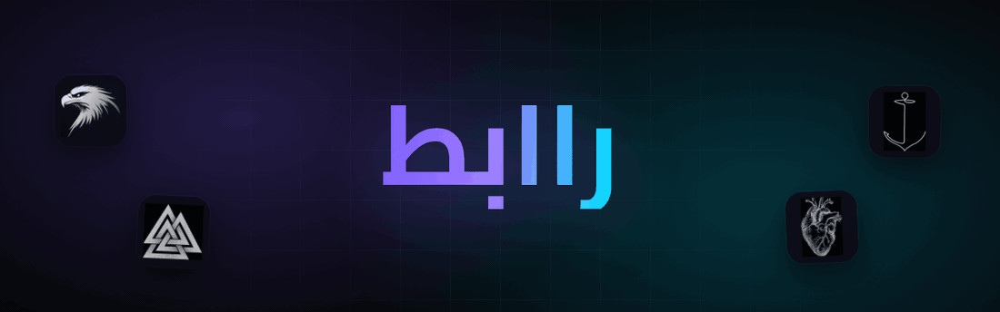
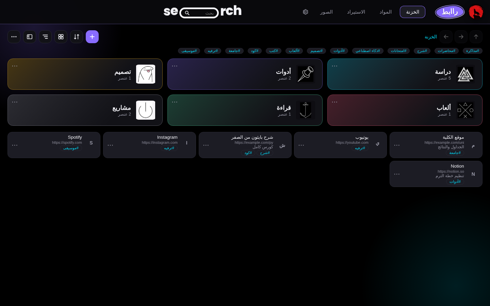
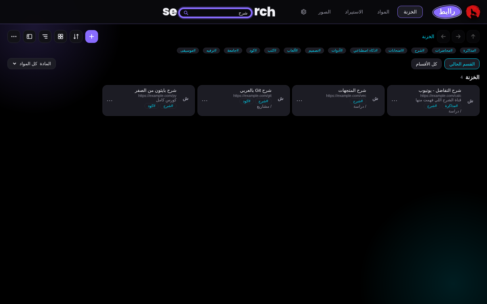
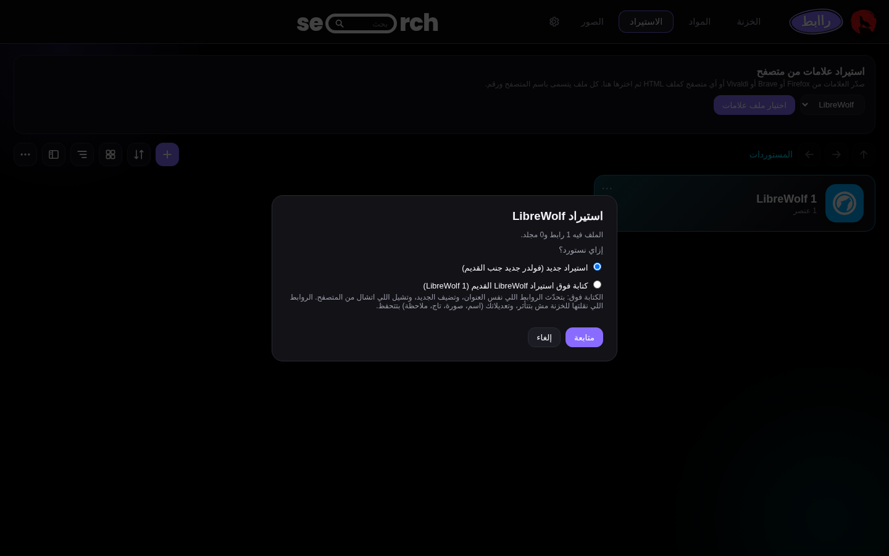
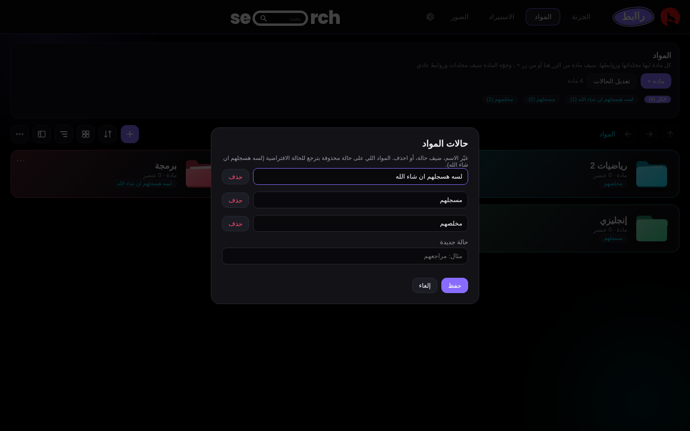

<p align="center">
  
</p>

# Raabt

**A portable, fully offline bookmark vault for Windows.** Nested folders, subjects with statuses, tags and notes, browser import, scoped export to HTML / Excel / Word / PDF, scheduled backups, and instant search — in one ~10 MB executable with no installer and no account.

[](https://github.com/AhmedRoza/Raabt/releases)
[](#privacy)
[](#tech-stack)
[](#tech-stack)
[](#tech-stack)
[](https://github.com/AhmedRoza/Raabt/releases/latest)

---

## Why

Every link you saved to read later ends up in one of three places: a tab you never close, a bookmarks bar you never open, or a note you never find again. Raabt puts them in one shelf that opens instantly, is arranged the way you think, and works with the network switched off.

No server, no account, no sync, no telemetry. One folder on your disk, and it is yours.

## Features

### A vault arranged your way
- Folders inside folders, at any depth, with custom colors and artwork.
- Tags and a short note on every link, shown right under it.
- 41 built-in folder images, or add your own from your machine.
- Drag and drop to reorder anything.
- Full dark theme and a light theme, plus custom accent colors that are kept for both.
- Pick from the bundled fonts or use the ones already installed on your PC.

### Your own sections
- Create extra sections that behave exactly like the vault: folders, drag and drop, search, trash, their own statuses, and their own backup.
- The built-in sections stay where they are; the ones you create sit next to them and can be renamed, reordered or removed.

### Subjects
- Each subject (a course, a term, a project) is a section of its own with folders and links inside.
- Statuses out of the box — *to enroll*, *enrolled*, *finished* — and you can rename them, add new ones, or delete them.
- Any folder or link from the vault can be dropped into a subject.

### Instant search
- `Ctrl + K` or `Ctrl + F` from anywhere, searching the current section or every section.
- Filter by subject or tag, and open a result straight away.

### Import from browsers
- Import the bookmarks file from Chrome, Firefox, Brave, Edge and others.
- Raabt asks whether this is a new import or an overwrite of an earlier import from the same browser, confirms before running, and can undo it afterwards.
- An overwrite keeps your edits: names, images, tags and notes.
- A mobile-app import mode reads the same HTML bookmarks file.

### Export and backup
- Export to HTML that opens in any browser, plus Excel, Word and PDF.
- Export the whole vault or only the folders and links you select.
- PDF saves straight to disk without a print dialog, with a collapsible folder tree and clickable link names.
- Every section has its own backup schedule — manual, on every launch, daily, weekly, monthly, a custom interval, or off — its own destination, and its own file.
- Backups are browser-importable HTML bookmark files named after the section, date and time, and they can be restored from inside Raabt with full detail.
- One encrypted backup per section, protected by a password you choose.
- A single backup file that contains every section, restorable on its own.
- A full-program backup that also carries your settings, plus a restore button next to it.
- Nothing overwrites an older backup, and a backup is only written when something actually changed.

### Small things that matter
- Check for links that no longer open, for one folder or the whole vault.
- Open every link in a folder in one click.
- Start with Windows, tray icon, and a global hotkey (`Ctrl + Alt + R` by default) — all off until you enable them yourself in Settings.
- A PIN lock if you want the vault to yourself.
- A statistics strip on the home screen: links, folders and sections, with a per-section breakdown.
- Reduce-motion support, and a switch in Settings to turn the animated wordmark off.

## Screenshots

| The vault | Search |
|---|---|
|  |  |

| Subjects and statuses | Import from a browser |
|---|---|
|  |  |

| Folder images | Backups |
|---|---|
|  |  |



## Run it

1. Download `Raabt.zip` from the [Releases](https://github.com/AhmedRoza/Raabt/releases) page and unzip it anywhere.
2. Run `raabt.exe`. There is no installer.
3. Raabt needs the **Microsoft Edge WebView2 Runtime**. It is already present on current Windows 10 and 11; if it is missing, the installer is available from Microsoft free of charge.

**Updating:** close the app, copy the `Raabt-data` folder somewhere safe, and replace `raabt.exe`. Do not delete `Raabt-data` — that is where everything lives.

**Moving it:** the whole program is one folder. Copy it to a USB stick and it keeps working; your data travels with it.

## Tech stack

| Part | What it is |
|---|---|
| Interface | HTML / CSS / JS in a single file, no external libraries |
| Engine | Rust compiled to WebAssembly (`src/`) — model, backups, Netscape import, export |
| Shell | Go + WebView2 (`shell/`) — window, files, global hotkey, start with Windows, tray |
| Images and fonts | Embedded in the executable, so the program stays a single portable file |

### Build from source

```bash
# 1) Engine (Rust -> WASM). Requires rustup and the wasm target.
rustup target add wasm32-unknown-unknown
cargo build --release --target wasm32-unknown-unknown
cp target/wasm32-unknown-unknown/release/raabt.wasm shell/raabt.wasm

# 2) Shell (Go -> exe). Requires Go 1.22+.
bash package.sh
```

The built `raabt.wasm` is committed, so if you are not changing the Rust engine you only need Go.

## Privacy

- **Fully offline.** No server, no account, no analytics, no tracking. The app runs with the network disabled.
- All data lives in a single `Raabt-data` folder next to the executable, under your control.
- The link checker is the only feature that touches the network, and only when you press it.

## Fonts

Raabt bundles open-licensed fonts — Cairo, Tajawal, Almarai, Amiri, IBM Plex Sans Arabic, Readex Pro, El Messiri, Playpen Sans Arabic, Inter, Poppins, Space Grotesk, JetBrains Mono, Playfair Display — with their licenses in [`LICENSES/`](LICENSES/).

## License

All rights reserved. The source is published for reading and review; no license is granted for reuse or redistribution without permission. See [LICENSE](LICENSE) for details.
